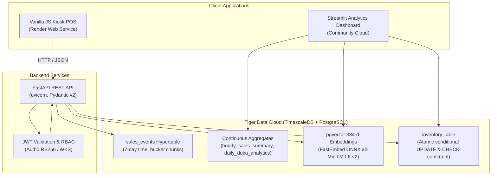

# DukaPulse

A POS and analytics system for Kenya's neighborhood dukas where concurrent checkouts cannot oversell.

[](https://github.com/princenzmw/DukaPulse/actions/workflows/ci.yml)
[](https://www.python.org/)
[](https://fastapi.tiangolo.com/)
[](https://www.postgresql.org/)
[](https://www.timescale.com/)
[](https://streamlit.io/)
[](https://auth0.com/)
[](https://www.docker.com/)
[](https://github.com/features/actions)
[](https://github.com/pgvector/pgvector)
[](https://opensource.org/licenses/MIT)

---

## Live Deployments

- **Kiosk POS & Concurrency Guard:** [https://dukapulse-kiosk.onrender.com/kiosk](https://dukapulse-kiosk.onrender.com/kiosk) — search "unga ya ugali", run atomic cash and M-PESA sales, or trigger an oversell race directly from the register interface.
- **Interactive Analytics Dashboard:** [https://dukapulse.streamlit.app](https://dukapulse.streamlit.app) — inspect 60-day sales telemetry, track rush-hour purchasing patterns, test role-based access control (Owner vs Staff margin redaction), and review 4-week demand forecasting benchmarks.

*Free-tier hosting sleeps after idle; the first load may take up to a minute while the service wakes.*

---

## Why It's Hard

### 1. Concurrency and the Oversell Hazard
In small kiosk retail, physical shelf space is constrained and items sell quickly. When multiple sales clerks or incoming mobile payment notifications attempt to claim the final item simultaneously, standard application-level read-modify-write patterns introduce race conditions that sell phantom inventory. DukaPulse enforces inventory safety directly at the database engine level. Every checkout performs an atomic conditional decrement in PostgreSQL:

```sql
UPDATE inventory 
SET current_stock = current_stock - :qty, updated_at = :sale_time 
WHERE shop_id = :shop_id AND product_id = :product_id AND current_stock >= :qty 
RETURNING current_stock;
```

Combined with an engine constraint `CHECK (current_stock >= 0)` on the inventory table and pessimistic row locks (`SELECT ... FOR UPDATE`) during restocking deliveries, simultaneous purchase attempts are serialized or rejected immediately with `InsufficientStockError` (HTTP 409 Conflict).

### 2. Honest Forecasting vs Phantom Precision
Small kiosks operate with sparse, intermittent transactional histories where complex deep learning models overfit and recommend excess inventory, tying up vital merchant working capital. DukaPulse runs a rolling backtest tournament across candidate forecasting algorithms. Across all 14 catalog products over a 60-day historical window, Holt Linear Exponential Smoothing failed to outperform a Seasonal-Naive baseline (repeating the previous cycle's weekly demand). Because a model only earns its compute budget if it achieves lower Mean Absolute Percentage Error (MAPE) than the baseline, DukaPulse defaults to the Seasonal-Naive model by design. The verified validation MAPE values (1.012% to 5.433% for the baseline versus 2.533% to 16.58% for the candidate model) are documented in [docs/receipts/forecast_mape.json](docs/receipts/forecast_mape.json).

### 3. Cross-Lingual Vernacular Retrieval
Consumers and shopkeepers in Kenyan neighborhoods rarely search product catalogs using formal manufacturer descriptions; they query using colloquial Swahili and Sheng loanwords (*"unga ya ugali"*, *"sabuni ya kuoga"*, *"mafuta ya kupika"*). Standard dense embedding tokenizers break these colloquial phrases into unrelated tokens that miss the target retail category. DukaPulse pairs an ONNX-served `all-MiniLM-L6-v2` dense model (384 dimensions) with a domain synonym expansion layer that maps recognized vernacular keywords into conceptual equivalents prior to vectorization, while preserving raw dense semantic matching for standard English search terms.

#### Measured Retrieval Benchmarks (Cosine Similarity on Live Catalog)

| Query Type | Input Query | Top Retrieved Product | Category | Cosine Similarity |
| :--- | :--- | :--- | :--- | :---: |
| Vernacular (In-Map) | `unga ya ugali` | Pembe Maize Flour 2kg | Flour & Grains | 0.8611 |
| Vernacular (In-Map) | `unga ya ugali` | Jogoo Maize Meal 2kg | Flour & Grains | 0.8039 |
| Vernacular (In-Map) | `sabuni ya kuoga` | Geisha Bath Soap 225g Aloe Vera | Personal Care | 0.6119 |
| Vernacular (In-Map) | `sabuni ya kuoga` | Omo Hand Washing Powder 500g | Household & Cleaning | 0.5488 |
| Vernacular (In-Map) | `mafuta ya kupika` | Fresh Fri Cooking Oil 2L | Cooking Oil & Fats | 0.7743 |
| Vernacular (In-Map) | `mafuta ya kupika` | Rina Salad Cooking Oil 1L | Cooking Oil & Fats | 0.6220 |
| Pure Dense (Out-of-Map) | `soap` | Geisha Bath Soap 225g Aloe Vera | Personal Care | 0.5005 |
| Pure Dense (Out-of-Map) | `soap` | Omo Hand Washing Powder 500g | Household & Cleaning | 0.4167 |
| Pure Dense (Out-of-Map) | `rice` | Daawat Traditional Basmati Rice 1kg | Flour & Grains | 0.5541 |
| Pure Dense (Out-of-Map) | `tea` | Ketepa Pride Tea Bags 50s | Dry Goods & Spices | 0.4965 |

---

## Verifiable Engineering Receipts

| Claim | Verified Reality & Proof | Source / Artifact |
| :--- | :--- | :--- |
| **10,000-Attempt Oversell Race** | 16 concurrent threads race 10,000 purchases for 1 unit on real PostgreSQL: exactly 1 success, 9,999 blocked, stock remains 0 (never negative). | [`tests/test_integration_engine.py#L160-L226`](tests/test_integration_engine.py#L160-L226) |
| **Timescale Hypertable Engine** | `sales_events` partitioned along 7-day intervals; continuous aggregates `hourly_sales_summary` and `daily_duka_analytics` refresh automatically. | [`tests/test_integration_engine.py#L76-L132`](tests/test_integration_engine.py#L76-L132) |
| **Measured Vector Retrieval** | `all-MiniLM-L6-v2` served via ONNX Runtime (FastEmbed) with verified cosine similarity on live cloud pgvector database. | [`dukapulse/services/semantic_search.py#L103-L150`](dukapulse/services/semantic_search.py#L103-L150) |
| **Idempotent Seed Pipeline** | Seeds 60 days of transactional history (6,314 sales events across 14 products) safely without duplicate key violations. | [`dukapulse/seed.py#L100-L250`](dukapulse/seed.py#L100-L250) |
| **RBAC Security & Redaction** | Staff role redacts wholesale unit costs and profit margins; unauthorized restocking mutations return HTTP 403 Forbidden. | [`dukapulse/auth/rbac.py#L25-L65`](dukapulse/auth/rbac.py#L25-L65), [`tests/test_rbac.py#L1-L85`](tests/test_rbac.py#L1-L85) |
| **Public Live Deployments** | Live Kiosk POS deployed on Render and interactive dashboard deployed on Streamlit Community Cloud backed by Timescale Cloud. | [Render Kiosk](https://dukapulse-kiosk.onrender.com/kiosk), [Streamlit App](https://dukapulse.streamlit.app) |

---

## Architecture



---

## Running Locally

### 1. Clone and Set Up Virtual Environment

```bash
git clone https://github.com/princenzmw/DukaPulse.git
cd DukaPulse

python -m venv .venv
# On Linux / macOS:
source .venv/bin/activate
# On Windows:
.venv\Scripts\activate
```

### 2. Install Dependencies and Editable Package

```bash
pip install -r requirements.txt
pip install -r requirements-dev.txt
pip install -e .
```

### 3. Configure Environment

Create a `.env` file at the repository root based on `.env.example`:

```bash
cp .env.example .env
```

Key environment configurations:
- `DATABASE_URL`: PostgreSQL connection string (defaults to local SQLite if unset).
- `DEV_MODE_MOCK_AUTH`: Local development ships a mock-token signer (`DEV_MODE_MOCK_AUTH=true`, secure-by-default); demo deployments enable it, production does not.

### 4. Run the Test Suite

```bash
python -m pytest tests/ -v
```

### 5. Launch Local Services

#### Option A: Native Processes

```bash
# Terminal 1: FastAPI Kiosk API
uvicorn dukapulse.api.main:app --host 0.0.0.0 --port 8000 --reload

# Terminal 2: Streamlit Analytics Dashboard
streamlit run app/streamlit_app.py
```

- Kiosk POS interface: `http://localhost:8000/kiosk`
- FastAPI OpenAPI documentation: `http://localhost:8000/docs`
- Analytics dashboard: `http://localhost:8501`

#### Option B: Docker Compose

```bash
docker compose up --build
```

---

## Technology Stack

- **Backend:** Python 3.12, FastAPI, Pydantic v2, SQLAlchemy 2.0, ONNX Runtime (FastEmbed)
- **Database & Storage:** PostgreSQL 16, TimescaleDB Hypertables & Continuous Aggregates, pgvector
- **Frontend:** Vanilla HTML5/CSS3/JavaScript (Kiosk POS), Streamlit (Analytics Dashboard), Plotly
- **Security & Identity:** Auth0 (RS256 JWT, JWKS, Role-Based Access Control)
- **Infrastructure & CI:** Docker, Render, GitHub Actions

---

## License

This project is licensed under the [MIT License](LICENSE).
